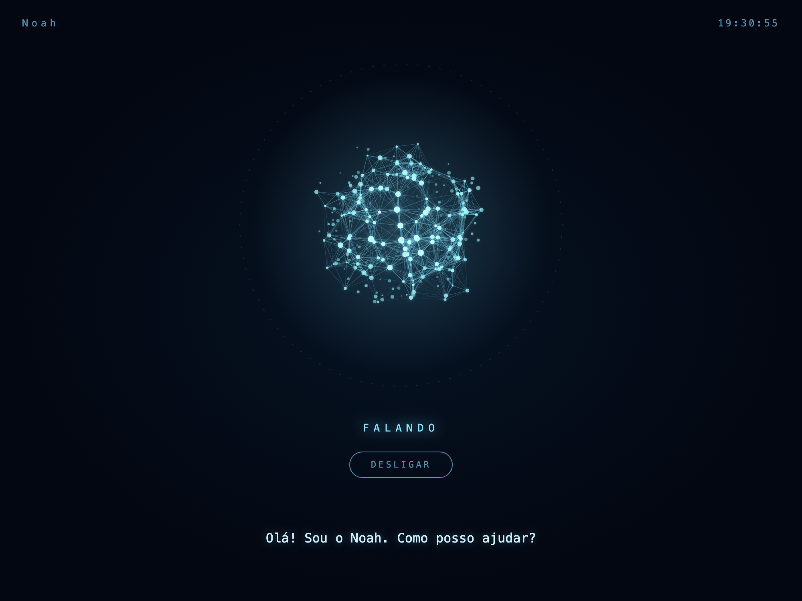

# Noah



*Prévia da interface real do HUD, renderizada com estado “Falando” e uma frase de demonstração.*

Veja [a migracao para Noah](docs/RENOMEACAO_NOAH.md).

Noah e o unico nome do produto. A ativacao padrao usa duas palmas.
Ativacao falada exige um detector Noah local, treinado e validado.

Assistente de voz local para conversar em português e organizar um perfil profissional com a origem de cada informação. A ativação padrão usa duas palmas; a ativação por voz depende de um detector local treinado e validado. Nome, tratamento e dados pessoais são configuráveis, para que cada pessoa mantenha sua própria instância.

100% local: o "cérebro" roda via [Ollama](https://ollama.com) na própria máquina —
nenhum dado do currículo ou da conversa sai do Mac, sem API paga, sem chave de nenhum
serviço em nuvem. O reconhecimento de voz (wake word + transcrição) também é
inteiramente local. Por padrao, duas palmas ativam a conversa, sem conta nem
modelo de palavra de ativacao. Nenhum detector e baixado automaticamente.

Estado atual: **Etapas 1-5 em andamento**. Diagnóstico, consolidação de dados + indexação
incremental, voz totalmente local e app de menu bar estão completos. O primeiro adaptador
de site (Gupy) já lê o perfil real, compara com o currículo local (*dry run*) e **grava
de verdade** nome e telefone -- tudo **verificado contra a conta ao vivo**, inclusive o
clique real em "Salvar". E-mail fica de fora por enquanto (é também o identificador de
login, e mudá-lo pode disparar um fluxo de verificação nunca testado); o restante do
currículo (experiência, formação, certificações) vive num sub-formulário da Gupy ainda
não inspecionado.

## Arquitetura

Todos os caminhos abaixo são relativos a `src/` (ex.: `assistant/providers.py` é
`src/assistant/providers.py`).

- **`assistant/providers.py`** — abstração `LocalLLMProvider`, com `OllamaProvider`
  (padrão) e `MLXProvider` (opt-in, `NOAH_LLM_PROVIDER=mlx`); qualquer chamador (conversa,
  importação, indexador) passa por essa interface, não por `ollama`/`mlx_lm` diretamente.
  O `MLXProvider` roda o modelo no próprio processo com o pacote opcional `mlx-lm` (Apple
  Silicon, fora do `requirements.txt`; import só quando escolhido), pesos em
  `NOAH_MLX_MODEL` (padrão `mlx-community/Qwen2.5-7B-Instruct-4bit`, que o `mlx_lm` baixa no
  primeiro uso). Decodificação gulosa, chamadas de ferramenta lidas dos blocos `<tool_call>`
  do Qwen (só ferramentas declaradas) e JSON estruturado via schema no prompt, sem a
  decodificação restrita do `format=` do Ollama. Coberto por testes com backend simulado;
  ainda não rodado com o `mlx-lm` real nem medido contra o Ollama. Manda `keep_alive` em toda chamada (`OLLAMA_KEEP_ALIVE`,
  padrão 30min) -- o padrão do próprio Ollama (5min) foi a causa real de respostas lentas
  medida na prática: qualquer intervalo maior entre ativações do Noah forçava um recarregamento
  frio do modelo (~30s) na resposta seguinte.
- **`assistant/coding_agent.py`** — agente de coding local (primeiro passo pra
  reduzir dependência de Claude/Codex hospedados em tarefas de engenharia), pela mesma
  abstração `LocalLLMProvider` acima, mas com modelo próprio (`NOAH_MODEL_CODING` --
  ver Setup) e um conjunto de ferramentas bem mais restrito: **somente leitura**
  (`read_file`/`list_directory`/`search_text`/`git_log`/`git_diff`/`run_tests`), preso a
  um workspace específico com proteção real contra sair da pasta (`WorkspaceViolation`).
  Ainda não edita nem executa nada -- primeira versão é propositalmente de
  auditoria/consulta, não de escrita.
- **`assistant/cerebro.py`** / **`assistant/cerebro_busca.py`** — integração com o
  segundo cérebro (cofre Obsidian). A ferramenta `consult_cerebro` ranqueia as notas
  localmente com BM25 (radical leve em português, stopwords, alguns grupos de sinônimos,
  título e "estado atual" com peso maior) e devolve trechos de até 8 linhas pertinentes por
  nota, com contexto, dividindo o orçamento de caracteres entre as notas. Só lê `.md`, só
  biblioteca padrão, sem modelo de embedding, e espelha os filtros da CLI do cofre.
  `NOAH_CEREBRO_BUSCA=cli` volta ao `buscar --trechos` da CLI, que também é o fallback
  quando o cofre não tem o protocolo e o único caminho de escrita.
- **`resume/schema.py`** — currículo canônico com procedência: cada item
  (experiência, certificação, projeto...) carrega uma lista de `Evidence` (arquivo de
  origem, tipo, data de leitura, trecho, confiança, status de revisão). Conflitos entre
  fontes viram um registro em `conflicts`, nunca uma sobrescrita silenciosa. Toda mudança
  aplicada gera uma entrada em `change_log` (auditoria).
- **`api_local.py`** — API local HTTP + JSON (F7) sobre o mesmo `send_turn` do modo
  texto: só biblioteca padrão, só loopback (ou token), um turno por vez e histórico só em
  memória. Ver "API local" abaixo.
- **`indexing/`** — escaneia apenas diretórios autorizados (`config.py` →
  `AUTHORIZED_INDEX_ROOTS`), ignora o próprio repositório do Noah e ruído de
  dependências (`node_modules`, `.git`, `obj/`, etc.), calcula hash de cada arquivo para
  pular o que já foi processado, e gera uma **proposta** revisável
  (`src/data/proposals/proposal_*.json`) — nunca escreve direto em `src/data/resume.json`.
- **`voice/`** — `wake_word.py` seleciona o motor via `WAKE_WORD_ENGINE`
  (`clap`, padrao; `openwakeword` com `NOAH_WAKE_WORD_MODEL_PATH`; ou `porcupine`
  com `NOAH_PORCUPINE_MODEL_PATH` e `PICOVOICE_ACCESS_KEY`). Motores de palavra
  exigem um detector Noah local validado. `stt.py` (faster-whisper) carrega
  o modelo só quando necessário e libera a memória (`unload()`) ao fim de cada sessão de
  conversa.
- **`sites/`** — `base.py` define a interface `SiteAdapter` (dry run sempre antes,
  `apply_changes` recusa sem `confirmed=True`, login sempre manual). `session.py` é a
  sessão Playwright persistente e reutilizável por qualquer site (login numa janela real
  e visível). `gupy.py` é o primeiro adaptador real -- ver "Adaptador da Gupy" abaixo.
  **Onde os dados de sessão ficam:** `~/Library/Application Support/Noah/sites/`
  (`LOCAL_STATE_DIR` em `config.py`), de propósito **fora** da pasta do projeto --
  todo o projeto vive dentro de uma pasta sincronizada com o OneDrive, e cookies de login
  reais (e, se algum dia houver, screenshots de evidência) nunca devem sair desta máquina
  nem pra uma nuvem que já é "confiada" por outro motivo. `src/data/resume.json` pode
  continuar em `src/data/` (dentro do projeto, sincronizado com o OneDrive) porque o
  schema já exclui de propósito CPF/RG/endereço/data de nascimento -- mas esse repositório
  Git é **público** no GitHub, o que é uma barra bem mais alta: por isso
  `src/data/resume.json` e `src/data/review/` estão no `.gitignore` e nunca são
  commitados, mesmo contendo só nome/telefone/e-mail/currículo. Cada pessoa gera o seu
  localmente (`scripts/import_resume.py`) e ele fica só na própria máquina. Ver
  `.env.example` para trocar o caminho do `LOCAL_STATE_DIR` (`NOAH_LOCAL_STATE_DIR`).
- **`menubar.py`** — app de menu bar (macOS) com botão liga/desliga; roda o loop
  de voz em background thread, controlado por `VoiceLoopController`. Inicia **desligado**
  (ícone visível, mas não ouvindo até você clicar) e sem ícone no Dock/Cmd-Tab (política de
  ativação "accessory"). Pode ser iniciado manualmente (`python src/cli.py menubar`) ou
  automaticamente no login via LaunchAgent -- ver "Iniciar automaticamente" abaixo. O botão
  "Abrir"/"Fechar" abre e fecha o HUD de `visualizer/` -- ver seção própria abaixo.
- **`visualizer/`** — HUD visual (círculo azul animado, estilo painel futurista) que
  reflete o estado real do Noah (desligado/em espera/ouvindo/falando) e o texto sendo
  ouvido/falado. `state.py` é um pub/sub em memória que `conversation.py`/`tts.py`/
  `menubar.py` publicam a cada transição real; `server.py` é um servidor HTTP local (só
  `127.0.0.1`, stdlib puro, sem dependência nova) que expõe `page.html` e um stream de
  eventos (Server-Sent Events). `native_window.py` abre isso numa janela nativa de verdade
  (WKWebView via PyObjC -- o mesmo motor do Safari) em vez de uma aba de navegador --
  tentamos primeiro abrir o Chromium do Playwright em modo app (`--app=`), mas ele mostrava
  um aviso "atualize o Chrome" por cima da página, o que não é problema com WebKit direto.
- **`assistant/presence.py`** — card de sugestões proativas no HUD (desligado por padrão,
  `NOAH_PRESENCE_ENABLED=true`). Conta por código, sem LLM e sem rede, o que já está em
  disco (propostas de currículo pendentes, conflitos em aberto, lembretes) e mostra cada
  item como fonte → por que importa → o que fazer; o Noah só sugere, nunca executa. Canal
  próprio em `visualizer/state.py` (`publish_presence`), independente do gráfico. Decisão
  em [`docs/ADR-0001-presenca-local-first.md`](docs/ADR-0001-presenca-local-first.md).
- **`central/`** — app Noah, com duas abas. **Pendências** lista as conversas do Claude
  Code e do Codex que terminaram e esperam uma resposta sua (mais os itens da presença do
  Noah) e deixa responder dali, no Mac ou no iPhone. **Presença** mostra as sugestões da
  presença (fonte → por quê → o que fazer), só leitura. `fontes.py` lê os transcripts
  locais por código, `resposta.py` retoma a conversa só em modo leitura e `servidor.py`
  serve o app (PWA em `central/pwa/`) na porta 8769. Decisão em
  [`docs/ADR-0002-central-de-pendencias.md`](docs/ADR-0002-central-de-pendencias.md).

## Setup

Não existe mais um pacote instalável (sem `pyproject.toml`/`setup.py`) -- `src/` é uma
pasta comum de módulos Python, não uma distribuição. Rodar um arquivo diretamente
(`python src/cli.py ...`, como nos exemplos abaixo) já resolve os imports internos
sozinho, porque o Python sempre coloca a pasta do próprio script no início do
`sys.path`, não importa de onde você chamou o comando. Os testes resolvem isso do jeito
deles, via `src/conftest.py`.

```bash
brew install python@3.12
python3.12 -m venv .venv
source .venv/bin/activate
pip install -r requirements.txt
cp .env.example .env   # opcional -- ver abaixo

# Modelo local (Ollama) -- roda como serviço em background, gerenciado pelo Homebrew
brew install ollama
brew services start ollama
ollama pull qwen2.5:7b   # ~4.7GB, baixa uma vez -- ~4x mais rápido que o 14b uma vez "aquecido"

# Só necessário para usar o agente de coding local (assistant/coding_agent.py) --
# modelo SEPARADO do de cima, de propósito (esse é escolhido por capacidade de
# código, não por latência de voz). ~9GB, baixa uma vez -- é o que roda de
# verdade numa máquina de 24GB de RAM.
ollama pull qwen2.5-coder:14b
# depois, no seu .env: NOAH_MODEL_CODING=qwen2.5-coder:14b

# Só se sua máquina tiver 64GB+ de RAM (ex.: um Mac mini/Studio) -- muito
# maiores, não rodam bem em 24GB. qwen3-coder:30b (~19GB, maduro, especializado
# em código) e nemotron-3.5-lightning:30b (~25GB, mais novo, feito pra
# "execução de agentes always-on") -- ver assistant/coding_agent.py pra
# comparação completa.
# ollama pull qwen3-coder:30b
# ollama pull nemotron-3.5-lightning:30b

# Só necessário se for usar os adaptadores de site (sites/) -- baixa o Chromium
# que o Playwright controla (não é o seu navegador normal, ~150MB, uma vez só)
playwright install chromium

# Só necessário para a voz clonada (voice/xtts_engine.py) -- ~4GB de
# dependências (torch/coqui-tts), comentadas por padrão em requirements.txt
# (descomente a seção "Voz clonada" lá antes de rodar o pip install acima) +
# FFmpeg do sistema (não é pacote Python, é lib nativa que o torchaudio
# carrega em runtime pra decodificar o clipe de referência). Ver "Voz
# clonada (XTTS-v2)" abaixo.
brew install ffmpeg
```

Nenhuma chave é obrigatória por padrão. `.env` só é necessário se você quiser usar o
Porcupine como motor de wake word (`WAKE_WORD_ENGINE=porcupine` + `PICOVOICE_ACCESS_KEY`)
em vez do openWakeWord padrão, apontar para um Ollama/modelo diferente, trocar a voz
do TTS padrão (`TTS_VOICE` -- ver `.env.example` para como achar uma boa voz masculina, já
que as que o macOS instala por padrão são de baixa qualidade), ou desligar a voz clonada
(`TTS_ENGINE=say`).

### Rodando para outra pessoa (ex.: um irmão/amigo)

Este projeto foi pensado desde o início pra não ficar preso a uma pessoa só -- cada um
roda sua **própria instância** (próprio clone, próprio `.venv`, próprio `.env`, próprios
dados locais), não uma instância compartilhada. Nada disso precisa mexer em código, só no
`.env` de cada um:

```bash
# Como o Noah se dirige a você (padrão: Nicholas / "Senhor Nicholas")
NOAH_USER_NAME=Fulano
NOAH_USER_HONORIFIC=Fulano          # ou "Senhor Fulano", "Doutor Fulano" etc.

# As frases exatas faladas na ativação/despedida -- se não setar, são geradas a
# partir dos dois acima com o texto padrão em português
NOAH_GREETING=Seja bem-vindo, Fulano... vamos começar o trabalho!
NOAH_CLAP_GREETING=Olá, Fulano, vamos começar o trabalho!
NOAH_GOODBYE=Até logo, Fulano.

# Onde ficam os SEUS currículos-fonte (.docx), pra "python src/scripts/import_resume.py"
# -- caminhos absolutos separados por ":" (o separador de path do seu sistema)
NOAH_SOURCE_RESUME_DOCS=/Users/fulano/Documents/Curriculo Brasil ATS.docx:/Users/fulano/Documents/Curriculo International ATS.docx

# Só necessário se você também usar OneDrive pro indexador incremental
# (python src/cli.py index) -- troca a raiz que AUTHORIZED_INDEX_ROOTS usa
NOAH_ONEDRIVE_ROOT=/Users/fulano/Library/CloudStorage/OneDrive-SuaOrg
```

Depois, rode `python src/scripts/import_resume.py` normalmente -- gera o **seu**
`src/data/resume.json` local, que nunca é commitado (está no `.gitignore` de propósito,
já que este repositório é público no GitHub -- ver "Arquitetura" acima). O arquivo
`~/Library/Application Support/Noah/application_profile.env` (RG/CPF/pretensão
salarial, se você usar os adaptadores de site) já é local por máquina, sem mudança
nenhuma necessária.

**Limitação conhecida, ainda não resolvida:** `find_matching_jobs`/`open_job_portal`
classificam vaga "perto de você" vs. "home office" usando uma lista de cidades fixa em
`sites/job_matching.py` (`_TARGET_REGION_TERMS`), hoje hardcoded pra região do Nicholas
(São Bernardo do Campo/ABC/São Paulo) -- ainda não é uma variável de ambiente. Pra outra
cidade, isso vai classificar errado até alguém parametrizar essa lista também.

## Uso

Consolidar o currículo mestre a partir dos currículos existentes (rodar uma vez, revisar
o resultado antes de confiar nele):

```bash
python src/scripts/import_resume.py
# revise src/data/review/resume_review.md e src/data/resume.json
python src/scripts/migrate_schema_v2.py   # só necessário se o resume.json for de antes do schema v2
```

Escanear currículos/certificados/cursos/projetos em busca de atualizações (nunca altera
`src/data/resume.json` diretamente -- gera uma proposta para revisão):

```bash
python src/cli.py index
python src/cli.py review-proposals   # aceitar/rejeitar/pular cada mudança, uma a uma
```

Conversar em modo texto (sem microfone, útil para depurar):

```bash
python src/cli.py --text-only
```

Modo de voz (bata duas palmas para ativar):

```bash
python src/cli.py
```

Ao ativar (palavra de ativação ou palma), o Noah fica em silêncio e só passa a ouvir --
sem falar nada antes de você dizer o que quer. Era diferente antes (um briefing/saudação
falado imediatamente), mas isso competia com o tempo de carregamento do worker de voz
clonada (~15-20s) e às vezes saía com a voz genérica em vez da voz do Noah -- um bug real,
não só um incômodo de UX. O briefing de pendências (mudanças de currículo, conflitos em
aberto, manchetes do dia sobre dados/IA -- `assistant/news.py`, RSS público do Olhar
Digital, nenhum dado seu enviado a lugar nenhum) continua existindo em `--text-only`
(`assistant/briefing.py`), só não é mais falado automaticamente no modo de voz.
O Noah também conhece as habilidades e certificações reais do currículo (Python, R, SQL,
Power BI, estatística, etc.) e comenta sobre dados com entusiasmo quando o assunto surge --
grounded no `src/data/resume.json`, não inventado (`assistant/llm_client.py`).
Se o modelo responder que fez algo ("Adicionei...", "Preparei...", "Consultei...") sem
nenhuma ferramenta correspondente ter rodado no turno, o `send_turn` devolve um aviso ao
modelo e dá mais uma tentativa; se ele insistir, o Noah diz que nada foi feito, em vez de
repetir a afirmação falsa. A ação nunca é executada no lugar do modelo.

Sugestões proativas (só leitura): `python src/cli.py presenca` lista o que está pendente
no formato fonte → por quê → ação, ou "Nada pendente." quando não há nada. Com
`NOAH_PRESENCE_ENABLED=true` no `.env`, o mesmo card aparece no canto do HUD ao clicar em
"Abrir" no menu bar; sem a flag, o HUD não mostra nada novo. Nenhuma fonte usa rede ou
nuvem, nem como fallback -- uma fonte ilegível é simplesmente pulada
([ADR-0001](docs/ADR-0001-presenca-local-first.md)).

Se as palmas não estiverem sendo detectadas (ou disparando à toa), meça o pico real do
seu microfone/ambiente antes de ajustar `CLAP_PEAK_THRESHOLD` no `.env`:

```bash
python src/cli.py calibrate-claps
```

App de menu bar (mesma coisa, com um ícone e botão liga/desliga -- e, acima dele, um botão
"Abrir"/"Fechar" pro HUD visual numa janela própria, sem navegador nenhum envolvido,
independente de Noah estar ligado ou não):

```bash
python src/cli.py menubar
```

Pra ele iniciar sozinho a cada login (ícone sempre disponível, sem precisar abrir terminal),
registre como LaunchAgent -- ajuste os caminhos pro seu usuário/pasta do projeto:

```bash
cp com.nicholasbirochi.noah.menubar.plist.example ~/Library/LaunchAgents/com.SEUUSUARIO.noah.menubar.plist
launchctl bootstrap gui/$(id -u) ~/Library/LaunchAgents/com.SEUUSUARIO.noah.menubar.plist
```

`RunAtLoad` liga sozinho no login; sem `KeepAlive`, então "Sair" no menu realmente encerra
até o próximo login (não fica sendo religado). Logs em `~/Library/Logs/Noah/menubar.log`.

**Ou como um app de verdade**, pra abrir pelo Launchpad/Spotlight/Finder em vez do terminal:

```bash
# só a primeira vez -- descomente a seção "Empacotamento" em requirements.txt, então:
.venv/bin/pip install -r requirements.txt
python src/scripts/generate_app_icon.py       # gera src/assets/AppIcon.icns -- só precisa rodar uma vez
python src/scripts/build_app.py               # cria /Applications/Noah.app
```

`Noah.app` é construído com o modo "alias" do `py2app` (`src/packaging/setup.py`) -- não é
um build congelado, continua rodando direto do `.venv`/código-fonte deste projeto (nada de
dependência empacotada junto). Um wrapper de bash simples foi tentado primeiro e não
funcionava de verdade: o `python@3.12` do Homebrew é um build "framework" do macOS, e o
próprio interpretador reexecuta silenciosamente pra dentro de
`.../Resources/Python.app/Contents/MacOS/Python` sempre que não é executado já como esse
binário exato -- isso troca a identidade do processo de `com.nicholasbirochi.noah` pra
`org.python.python`, e foi exatamente isso que quebrava o ícone da barra de menu (o processo
ficava vivo, sem erro nenhum no Python, e o ícone nunca aparecia -- só visível pelo
Console.app: `AppKit:StatusBar] scene activation failed`). O modo alias do py2app usa um
stub compilado próprio que embute o interpretador via API C em vez de reexecutar o binário
do Python, então esse problema nunca acontece. **Não rode o app manual e o LaunchAgent
automático ao mesmo tempo** -- duas instâncias tentando pegar o microfone ao mesmo tempo
causa exatamente o tipo de falha silenciosa que já vimos antes (o Noah já tem uma trava
própria contra isso, mas é melhor nem depender dela).

**Primeira vez que for abrir, um passo manual é obrigatório:** clique com o botão direito
(ou Control-clique) em `Noah.app` → **Abrir** → confirme no aviso. Isso não é bug --
`build_app.py` já assina o app com uma assinatura ad-hoc (`codesign --sign -`, gratuita,
sem conta de desenvolvedor), mas isso sozinho não satisfaz o Gatekeeper do macOS pra um
duplo-clique direto normal em Apple Silicon; sem clicar em "Abrir" uma vez, o clique
simplesmente **não faz nada visível, sem erro nenhum** (`spctl --assess` mostra
`rejected`). Depois desse primeiro "Abrir" confirmado, duplo-clique normal funciona
para sempre. `spctl --add` (que permitiria liberar isso via terminal, sem esse passo
manual) foi descontinuado pelo próprio macOS -- não tem como pular essa etapa.

`codesign --verify` passa no app instalado, mas `codesign --verify --strict` falha
("No such file or directory") e isso é esperado: o modo alias monta o bundle com links
para o `.venv` e o `src/` do projeto (fora do bundle, o que o `--strict` recusa), e dois
desses links (`lib/python3.12/config` e `site.pyc`) apontam para arquivos que não
existem. Só um app congelado passaria no `--strict`; detalhes em
`docs/RENOMEACAO_NOAH.md`.

## API local (F7, primeira versão)

O mesmo turno de conversa do modo texto (`send_turn`, com as mesmas ferramentas e
travas), exposto por HTTP + JSON em `src/api_local.py` -- só biblioteca padrão, sem
FastAPI/uvicorn:

```bash
python src/api_local.py                      # http://127.0.0.1:8768
curl -s http://127.0.0.1:8768/saude
curl -s -X POST http://127.0.0.1:8768/conversa -H 'Content-Type: application/json' \
  -d '{"mensagem": "oi, Noah"}'               # devolve {"sessao", "resposta"}
```

Mande o `sessao` devolvido nos próximos pedidos para manter o histórico;
`DELETE /sessoes/<id>` o apaga. O histórico fica só em memória (até 32 sessões, 200
mensagens cada). Escuta só no `127.0.0.1`; um endereço fora do loopback é recusado sem
token (`NOAH_API_TOKEN` ou `--token`, enviado como `Authorization: Bearer ...`). O POST
exige `Content-Type: application/json` e um `Host` local, o que barra formulários de
outras páginas e DNS rebinding. Um turno roda por vez. Porta: `NOAH_API_PORT` ou
`--porta` (8765 é o HUD, 8766 o XTTS e 8767 o portal). Sem streaming nem WebSocket
nesta versão: a resposta chega inteira no fim do turno.

## App Noah: central de pendências e presença

O app Noah (`python src/cli.py central`) tem duas abas: **Pendências**, descrita abaixo,
e **Presença**, com as sugestões da presença (ADR-0001).

A aba Presença lê `GET /central/api/presenca`, só leitura. Cada item mostra a fonte, o
porquê e o que fazer. Ela segue a mesma chave do HUD: com `NOAH_PRESENCE_ENABLED`
desligada (o padrão), a aba diz "Presença desligada" e explica como ligar, sem contar
nada. Para ligar, ponha `NOAH_PRESENCE_ENABLED=true` no `.env` e abra o app de novo.
Ligada e sem nada a sugerir, ela fica quieta ("Nada agora"). Uma fonte ilegível é pulada,
e se a leitura toda falhar a aba avisa, sem número chutado.

### Pendências (Claude Code, Codex e Noah)

Uma lista só do que está esperando você: conversas do Claude Code e do Codex cujo último
turno terminou com uma resposta do agente, mais os itens da presença do Noah (só leitura,
com `NOAH_PRESENCE_ENABLED=true`). Tudo é lido do disco por código, sem modelo e sem
rede: `~/.claude/projects/` e `~/.codex/sessions/` (títulos em
`~/.codex/session_index.jsonl`), janela de 3 dias e no máximo 40 itens.

```bash
python src/cli.py pendencias   # lista no terminal
python src/cli.py central      # página em http://127.0.0.1:8769/central/
```

Na página, cada cartão mostra a fonte, o título, o projeto e a última mensagem do agente.
"Responder" retoma a própria conversa em segundo plano, **sem editar nada**:

- Claude: `claude -p --resume <id>` em modo `plan`, só com as ferramentas Read, Grep e
  Glob e sem servidores MCP;
- Codex: `codex exec resume <id>` com `sandbox_mode="read-only"`.

A mensagem vai pelo stdin (até 4.000 caracteres), uma resposta por conversa por vez e no
máximo duas ao mesmo tempo. Para o agente mudar arquivos, abra a conversa no app.
"Dispensar" esconde o item até chegar uma resposta nova naquela conversa (marca local em
`LOCAL_STATE_DIR/central/dispensadas.json`).

Cada item diz também se a última mensagem pede algo a você (`pergunta`). A regra é
textual, sem modelo: olha os últimos 400 caracteres, sem blocos de código e links, e
procura um "?" ou um pedido explícito ("me avise", "aguardo", "você autoriza", "let me
know"...). Sem isso, o item é uma **resposta pronta**: continua na lista e dá para
responder, mas não conta como "Esperando você" na ilha, na Live Activity e nos widgets
(conta como pronta). Itens do Noah sempre contam como pergunta.

O botão **Aceitar** só aparece numa pergunta simples (`simples`), que um "sim" responde:
uma pergunta curta de sim ou não no fim ("Posso fazer o push?", "Quer que eu abra a PR?",
"Aguardo seu ok"). Pergunta aberta (qual, como, o que...), lista com 3 ou mais opções,
mais de duas perguntas ou pergunta longa pedem resposta escrita: o app mostra só
Responder. Vale igual para Claude e Codex; itens do Noah nunca têm Aceitar.

No iPhone, pelo Wi-Fi de casa:

1. No Mac: `python src/cli.py central --host "$(ipconfig getifaddr en0)" --token
   "$(openssl rand -hex 16)"` (fora do `127.0.0.1` o token é obrigatório). Guarde o
   token que você gerou.
2. No Safari do iPhone, abra `http://<IP do Mac>:8769/central/`, cole o token no campo
   da página e use "Adicionar à Tela de Início". O ícone (PNG de 180 px) e o nome "Noah"
   vêm do manifesto. Esse caminho ainda não foi testado num iPhone de verdade.

As travas são as mesmas da API local: `Host` conferido, `Origin` de outro endereço
recusado, `Authorization: Bearer` nas rotas de dados (pendências e presença), POST só
com JSON e corpo de até 64 KB, sem CORS. A página, o manifesto e os ícones abrem sem
token porque não têm dado nenhum.

Variáveis opcionais: `NOAH_CENTRAL_TOKEN`, `NOAH_CENTRAL_PORT` (padrão 8769),
`NOAH_CLAUDE_BIN` e `NOAH_CODEX_BIN` (caminho das CLIs). Sem `NOAH_CODEX_BIN`, a
central usa o `codex` que vem dentro do app ChatGPT/Codex, que é a mesma versão que
gravou as conversas. Só se ele não existir é que ela recorre ao PATH: um `codex`
antigo no PATH recusa o modelo configurado no app.

Limites conhecidos:

- só funciona na rede de casa; fora dela precisaria de uma VPN (Tailscale), ainda não
  instalada;
- sessões automáticas (`claude -p`, `codex exec`, subagentes) e conversas arquivadas no
  Codex não aparecem;
- se a conversa estiver aberta no app do Claude ou do Codex, talvez seja preciso
  reabri-la para ver o turno enviado pela central;
- os formatos dos transcripts não são uma API pública: se mudarem, a fonte é pulada
  (a página avisa "Fonte com problema"), nunca inventada;
- com a presença ligada, os itens dela aparecem nas duas abas: em Pendências como
  cartões "Noah" (só leitura) e na aba Presença com o "o que fazer".

### App nativo (iPhone e Mac)

Em `apple/` há um app SwiftUI com Central, Pendências, Presença, Fluxo e Ajustes,
que lê a mesma central. A central sincroniza os dois aparelhos: o que você aceita, responde ou dispensa
num some do outro.

- A Central reúne a conversa com o Noah, os modelos locais e a atividade do Cérebro.
  Voz e digitação usam a mesma conversa, mantida em memória no Mac. O reconhecimento
  de voz exige português disponível no aparelho; sem ele, a digitação continua disponível.
  O microfone fecha enquanto o Noah pensa ou fala.
- Pendências mostra Para fazer, Geradas automaticamente pelo Noah (marcadas) e Respostas.
  Tocar numa tarefa abre o detalhe com o porquê e as ações.
- Central e Fluxo atualizam a cada 2 s enquanto visíveis. As outras abas atualizam a
  cada 20 s, ou 4 s enquanto há resposta em andamento.
- O painel "Ao vivo" mostra a sincronização e o feed do que mudou.
- Cada pendência nova vira um aviso com Responder e Dispensar, e Aceitar quando a pergunta
  é simples (sim ou não).
- A aba Fluxo anima o caminho da informação: as ligações com a central têm partículas
  ao vivo. As consultas ao Cérebro e as tarefas delegadas ao Qwen também, com a contagem
  dos últimos 10 minutos lida em `GET /central/api/cerebro`. A central conta só chamadas
  de ferramenta que executam `cerebro.py` ou `auxiliares.py` nos transcripts locais, mais
  as consultas do Noah (só o horário). Se uma fonte falha, a ligação fica tracejada, "sem
  sinal ao vivo", sem número chutado.
- O Cérebro aparece em pedaços, nas 8 pastas do cofre. Acendem as pastas que cada agente
  tocou, e o bonequinho dele anda até elas. A central manda só o código da pasta (`partes`),
  tirado dos caminhos de nota que a resposta da ferramenta trouxe.
- No iPhone, a ilha dinâmica e a tela bloqueada mostram o estado: azul "Trabalhando",
  âmbar "Esperando você" com "!" e verde "Tudo pronto". O esquema completo inclui
  widgets de resumo; o esquema pessoal mantém a Live Activity sem exigir App Group.
- Responder, Aceitar e Dispensar pedem Face ID no iPhone e Touch ID no Mac. Ilha e widgets
  só abrem o app.
- No Mac, o painel da barra de menus lista as pendências e abre o app do agente.
  Abrir Noah pelo menu ou por `noah://` reutiliza uma única janela principal.
- No Mac, uma ilha no notch mostra o mesmo estado. Ela abre com o mouse, fecha pouco depois
  que ele sai e, com o Alcove aberto, encosta ao lado dele.
- Na ilha aberta, cada item tem a etiqueta "Pergunta" ou "Resposta pronta". Clicar na
  linha mostra, de forma opcional, a mensagem inteira e um campo "Sua resposta" (Return
  envia, com Touch ID), além de "Abrir no Noah" e "Dispensar". Enquanto você escreve, a
  ilha não fecha quando o mouse sai; fecha quando o campo perde o foco.
- O ícone é um botzinho preto e branco, gerado por `src/scripts/generate_app_icon.py`.

Como gerar, instalar no iPhone e ligá-lo pela rede de casa está em
[apple/README.md](apple/README.md). A decisão está em
[docs/ADR-0003](docs/ADR-0003-app-nativo.md).

## Pedir uma mudança de código por voz

Pedir pro Noah ("mude a cor do HUD pra verde", "peça pro Claude Code revisar o
adaptador da Gupy") faz ele escrever um prompt completo e bem estruturado -- não a sua
fala ao pé da letra -- e copiar pra área de transferência (`prepare_claude_prompt` em
`assistant/tools.py`). Não existe uma forma de o Noah colocar texto direto numa
conversa já aberta com o Claude Code, então isso é proposital, não uma limitação: é só
colar (`Cmd+V`) onde e quando você quiser -- nesta conversa, numa nova, sobre este
projeto ou outro. Cada prompt também fica salvo em
`~/Library/Application Support/Noah/claude_prompts.log`, como rede de segurança caso
você não cole na hora.

## Voz clonada (XTTS-v2)

`voice/xtts_engine.py` clona uma voz a partir de um clipe curto de referência (em
vez de usar uma das vozes prontas do macOS). É o motor padrão (`TTS_ENGINE=xtts`), mas só
entra em ação se as duas condições abaixo forem verdadeiras -- **sem elas, `speak()` cai
de volta pra voz padrão (`TTS_VOICE`, ex: Felipe) automaticamente, sem erro nenhum**:

1. Seção "Voz clonada" descomentada em `requirements.txt` e `pip install -r
   requirements.txt` rodado (~4GB: torch + coqui-tts).
2. Um clipe de referência salvo em `~/Library/Application Support/Noah/voice/noah_reference.wav`
   (`TTS_XTTS_SPEAKER_WAV_PATH` em `config.py`) -- **de propósito fora da pasta do
   projeto** (que é sincronizada com o OneDrive) e **nunca baixado por mim/pelo Noah**:
   é dado biométrico de voz, você quem coloca esse arquivo lá.

Também precisa do FFmpeg instalado no sistema (`brew install ffmpeg`) -- não é dependência
Python, é a lib nativa que o `torchcodec` (leitor de áudio do torchaudio) carrega em tempo
de execução para decodificar o clipe de referência; sem ela, a síntese falha com um erro
claro (`Could not load libtorchcodec`) apontando exatamente pra isso.

**Roda num processo separado, de propósito.** Achado ao vivo: carregar o XTTS no mesmo
processo do loop de voz fazia o `torchcodec` carregar o FFmpeg do Homebrew no mesmo espaço
de memória que já tinha a própria cópia do FFmpeg do `faster-whisper` (via PyAV) carregada
-- o macOS registrava uma colisão de classe Objective-C real
(`AVFFrameReceiver`/`AVFAudioReceiver` definidas nas duas cópias), e a detecção de wake
word/palmas parava de disparar por completo, silenciosamente. Corrigido de verdade
rodando a síntese como um processo próprio:

- `voice/xtts_worker.py` -- sobe um servidor HTTP local (só `127.0.0.1`, stdlib
  puro) e carrega o modelo, isolado do processo principal. Nunca importa `faster-whisper`
  nem toca no microfone -- confirmado ao vivo que roda sem nenhum aviso de colisão.
- `voice/xtts_client.py` -- roda no processo principal (`conversation.py`), sobe o
  worker como subprocesso (`ensure_worker_started()`) e fala com ele por HTTP
  (`/health`, `/synthesize`). `tts.py` só conhece esse client, nunca o `xtts_engine`
  diretamente.

**Números reais medidos neste Mac (M5, 24GB RAM), incluindo o processo isolado:**
- Carregar o modelo no worker: ~13-18s. Roda em `device="cpu"`, não `mps` -- medido CPU
  mais rápido que MPS pra esse modelo (3,4s vs 11,4s pra gerar a mesma frase curta).
- Gerar fala: **7,8s para uma frase de ~7s** (quase tempo real) e **21,3s para uma fala de
  29,7s** (0,72x -- mais rápido que tempo real) -- medido isolado, antes de mover pro worker.
- **Confirmado ao vivo, de ponta a ponta**: worker isolado sobe, fica pronto, sintetiza via
  HTTP, e o processo principal (mesmo importando `faster-whisper` junto) não mostra nenhum
  aviso de colisão -- os três cenários testados separadamente antes de religar no loop real.
- Enquanto o worker ainda não carregou (ou não há clipe de referência), `speak()` usa a voz
  padrão normalmente -- nunca trava esperando.

## Adaptador da Gupy

Recomendação seguida: **Gupy primeiro, não LinkedIn.** O LinkedIn tem infraestrutura de
anti-automação bem documentada e agressiva (impressão digital comportamental/de
dispositivo, rate limiting, CAPTCHA, e termos de uso explícitos contra automatizar edição
de perfil) — risco real de restrição de conta desproporcional a automatizar algumas
edições pontuais. A Gupy é um ATS brasileiro voltado a candidatos, com perfil editável
como ação de usuário esperada e de primeira classe.

Login (uma vez só -- abre uma janela real de navegador, você loga normalmente, a sessão
fica salva):

```bash
python src/cli.py gupy-login
```

Ver o que mudaria no perfil da Gupy vs. o currículo local, sem aplicar nada:

```bash
python src/cli.py gupy-preview
```

Aplicar de verdade (pede confirmação explícita antes de enviar):

```bash
python src/cli.py gupy-apply
```

**O que já está verificado contra o site real, incluindo o envio de verdade:** login
persistente, leitura do perfil (nome/e-mail/telefone), comparação com o currículo local,
e a gravação real de **nome** e **telefone** -- clique real em "Salvar", confirmado ao
vivo (toast "Dados salvos com sucesso!", re-leitura do perfil depois do envio pra provar
que a mudança realmente pegou, registro de auditoria em JSON -- campo/valor
antigo/valor novo/quando, **não** um screenshot, já que a mesma tela também mostra CPF e
data de nascimento -- salvo fora da pasta do projeto, ver a seção "Arquitetura" acima,
`sites/`, para onde exatamente). **O que falta, de propósito:** **e-mail** não é
escrito -- é também o identificador de login, e mudar esse campo pode disparar um fluxo
de verificação (código, confirmação por e-mail) que nunca foi observado; um plano que
inclua uma mudança de e-mail faz `apply_changes` recusar o pacote inteiro
(`NotImplementedError`) em vez de aplicar só parte dele. Experiência, formação e
certificações também ficam de fora -- vivem num sub-formulário separado da Gupy
("Meu currículo") ainda não inspecionado.

## Patrimônio e saldos dos bancos

A ferramenta `evaluate_investments` lê a planilha de patrimônio que você mesmo mantém
(`NOAH_PATRIMONIO_PATH`; só leitura, nunca grava e nunca entra no índice de documentos).

Opcionalmente, os **saldos por banco** podem vir ao vivo do [Meu Pluggy](https://github.com/pluggyai/meu-pluggy)
(Open Finance, grátis para pessoa física) em vez da planilha. Está **desligado por padrão**:

```bash
# no seu .env
NOAH_FINANCE_SOURCE=pluggy        # padrão: planilha (nunca usa a rede)
```

Como funciona (`src/finance_pluggy.py`, só biblioteca padrão):

- **Só leitura.** O módulo aceita apenas `POST /auth`, `GET /accounts` e `GET /investments`;
  qualquer outra chamada (pagamento, Pix, transferência, edição de Item) é recusada antes de
  sair da máquina.
- **A senha do banco nunca passa pelo Noah.** Você cria a conta no Meu Pluggy e no painel da
  Pluggy, e dá o consentimento dentro do próprio banco. O Noah só precisa de três valores,
  guardados no Keychain do macOS:

  ```bash
  security add-generic-password -s noah-pluggy -a client_id -w
  security add-generic-password -s noah-pluggy -a client_secret -w
  security add-generic-password -s noah-pluggy -a itens -w   # "Inter BR=<itemId>,Itaú=<itemId>"
  ```

  (`-w` sem valor faz o `security` pedir o segredo sem deixá-lo no histórico do shell.)
  Sem Keychain, valem `NOAH_PLUGGY_CLIENT_ID`, `NOAH_PLUGGY_CLIENT_SECRET` e
  `NOAH_PLUGGY_ITEMS` no `.env`, que fica fora do git. Nada disso vai para o repositório.
- **Leitura na hora, sem cache.** Cada pergunta faz uma leitura nova; nada é gravado em disco.
- **A planilha é a reserva.** Bancos fora do mapa (como o Inter US, conta em dólar) e bancos
  cuja leitura falhar mantêm os números da planilha, e a resposta diz quais vieram de onde.
  Um Item que volta vazio (consentimento expirado) é tratado como "sem dados", nunca como
  saldo zero. Entradas e despesas continuam vindo só da planilha.

## Testes

`pytest` já vem no `requirements.txt` base (seção "Dev").

```bash
pytest src/tests/
```

Roda de qualquer diretório -- `src/conftest.py` garante que `src/` está no `sys.path`
antes da coleta, independente de onde `pytest` foi chamado.

### Benchmark de latência dos modelos (F14)

```bash
python src/scripts/benchmark_llm.py --plano   # só confere instalação e memória, não carrega nada
python src/scripts/benchmark_llm.py           # qwen2.5-coder:7b/14b e qwen3-coder:30b
```

Mede TTFT, tokens/s de geração e de leitura do prompt (números do próprio Ollama) e tempo de
carga, com prompts fixos, `temperature=0`, `seed`, `num_predict` e `num_ctx` fixos; o JSON
(padrão `src/data/llm_benchmarks/`, ou `--saida`) guarda a configuração inteira e as
medianas. Nunca baixa modelo (ausente = `nao_instalado`). Guarda de memória: se o modelo
(com folga) não cabe na memória disponível do `vm_stat`, nem carrega (`pulado_memoria`); se o
swap cresce mais que `--swap-max-mb` (512) durante a geração, interrompe e descarrega
(`abortado_swap`). Numa rodada de 2026-10-18 neste Mac (M5, 24 GB, swap já em 2,6 GB), o
7B deu mediana de ~22 tok/s e TTFT ~0,12 s com o modelo quente; o 14B e o 30B foram pulados
pela guarda (precisariam de ~11 e ~21 GB, havia ~8 GB livres). Com `seed` e `temperature=0`
a contagem de tokens ainda variou um pouco entre tentativas (142 vs. 147 num prompt).

## Roadmap

- E-mail na Gupy: testar ao vivo, supervisionado, se mudar o e-mail dispara algum fluxo
  de verificação -- só então liberar em `_WRITABLE_FIELDS` (`sites/gupy.py`).
- Sub-formulário "Meu currículo" da Gupy (experiência, formação, certificações,
  habilidades) -- inspeção ao vivo ainda não feita, hoje o adaptador só cobre a tela de
  contato.
- Catho: login/check_session funcionando (`sites/catho.py`) -- falta inspecionar a
  página real do perfil (precisa de sessão autenticada) para implementar o resto. Só
  funciona com navegador visível (`headless=False`); a versão headless leva 403 do próprio
  site, confirmado ao vivo.
- Vagas.com: **pausado** de propósito -- o site fica atrás de Cloudflare e derruba a conexão
  do Playwright mesmo com navegador visível (`net::ERR_CONNECTION_RESET`), sinal mais forte
  de anti-automação que a Gupy. Mesmo raciocínio do LinkedIn (`sites/base.py`): não
  vale escalar para técnicas de evasão. Só `check_session`/`login` implementados.
- InfoJobs: leitura completa e confiável (`sites/infojobs.py`) -- o melhor dos três
  sites testados até agora, Playwright alcança normalmente tanto headless quanto com
  navegador visível, sem bloqueio nenhum. `check_session`/`inspect_current_profile`/
  `build_update_plan`/`preview_changes` funcionam de verdade contra a sessão real
  (confirmado ao vivo: achou corretamente que o sobrenome salvo no site, "Biroch", diverge
  do currículo local, "Birochi"). **Escrita bloqueada por uma causa raiz já identificada, não
  por um bug do adaptador**: o clique em "SALVAR CV" roda a validação JS da própria InfoJobs
  (`Validate_CV_Step2`, achada lendo o bundle `HandlerCssJS.ashx` ao vivo) sobre a página
  inteira antes de mandar qualquer coisa pro servidor -- e a conta tem um campo obrigatório
  vazio sem relação nenhuma com nome/telefone: "Preferências > Selecione até 3 Áreas de
  Atuação" (`#ctl00_phMasterPage_cPreferences_hdnCategory`). Isso bloqueia QUALQUER
  salvamento nessa página, não só os deste adaptador. `apply_changes` agora recarrega a
  página antes de reconferir (uma correção real: sem isso, ele lia os próprios `<input>` que
  tinha acabado de preencher e reportava sucesso falso -- aconteceu de verdade numa tentativa
  antes desse fix) e captura o alerta JS real via `page.on("dialog", ...)`, então já responde
  `Falhou` com o motivo exato em vez de mentir ou de dar um erro vago. Falta um passo manual,
  único, do usuário: entrar no InfoJobs, Currículo > Editar > Preferências, escolher pelo
  menos uma Área de Atuação e salvar uma vez -- depois disso a escrita automatizada deve
  funcionar (ainda não reverificado, já que é uma escolha de carreira do usuário, não algo
  que o código deva decidir sozinho).
- Indeed: login/check_session e busca de vagas funcionando (`sites/indeed.py`),
  mas **IP levou bloqueio 403 do próprio Indeed depois de algumas buscas seguidas em pouco
  tempo** (confirmado ao vivo até com `curl` puro, não é coisa do Playwright) -- mesma
  postura do Vagas.com: não escalar para evasão, só evitar bater nele com frequência por
  enquanto. Só funciona com navegador visível (`headless=False`); a versão headless leva 403
  "Blocked - Indeed.com" à parte, confirmado ao vivo. URL de login real é a "Acessar" (não
  "Entrar"/"Login") na home do br.indeed.com. Falta inspecionar a página real do perfil
  (precisa de sessão autenticada) para implementar o resto.
- Academia do Universitário -- ainda não investigado; precisa da mesma verificação ao vivo
  (domínios, seletores reais, e depois o envio real) feita para os outros sites, não dá pra
  generalizar sem repetir esse processo por site.
- MLXProvider: instalar `mlx-lm`, rodar de verdade e medir latência contra o Ollama antes
  de pensar em torná-lo padrão (o código e os testes simulados já existem).
- API local (F7), próximo passo: FastAPI + WebSocket para resposta em streaming, depois
  de autorizar a dependência; acesso pelo iPhone só via VPN privada e com token.
- Central de pendências: testar de verdade no iPhone; acesso fora de casa (Tailscale,
  depende de autorização); juntar com a API local (8768) quando as duas estiverem
  estáveis; respostas do Noah como fonte respondível.
- Itens extras no menu bar (abrir logs/perfil, revisar propostas pendentes direto do
  menu -- hoje só tem liga/desliga).
- Presença proativa, próximas fatias (cada uma com decisão própria, sempre local e sem
  fallback de nuvem -- ver ADR-0001): rotinas agendadas por horário (agendador local),
  novas fontes contáveis (Cérebro, Pontos Loop), resumo falado opcional e ações que só
  rodam depois de aprovação explícita.

## Licença

Código e documentação autorais sob [MIT](license).
